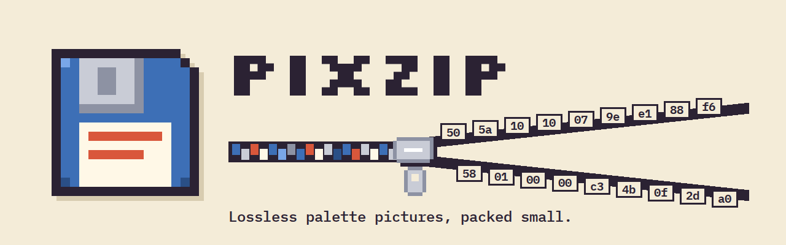

<p align="center"></p>

<p align="center">
  <a href="https://github.com/iamkaf/pixzip/actions/workflows/ci.yml"><picture><source media="(prefers-color-scheme: dark)" srcset="https://shieldcn.dev/github/ci/iamkaf/pixzip.svg?workflow=ci.yml&amp;branch=main&amp;variant=outline&amp;size=sm&amp;font=geist&amp;mode=dark"></picture></a>
  <a href="https://github.com/iamkaf/pixzip/releases"><picture><source media="(prefers-color-scheme: dark)" srcset="https://shieldcn.dev/github/release/iamkaf/pixzip.svg?variant=outline&amp;size=sm&amp;font=geist&amp;mode=dark"></picture></a>
  <a href="LICENSE"><picture><source media="(prefers-color-scheme: dark)" srcset="https://shieldcn.dev/badge/license-MIT.svg?variant=outline&amp;size=sm&amp;font=geist&amp;mode=dark"></picture></a>
</p>

Pixzip is a lossless codec for palette pictures: pixel art, sprites, tile sheets and portraits of up to 256 colours. Its decoder is about 1.4 KB of freestanding C. It was built for Pinion, a game that has to fit on one floppy disk, and on Pinion's pictures it comes out 18% smaller than oxipng and 11% smaller than lossless WebP. The format is documented bit for bit in [FORMAT.md](FORMAT.md).

| Picture | Pixels | Colours | PNG | oxipng | zopflipng | WebP | GIF | Pixzip |
|---|---:|---:|---:|---:|---:|---:|---:|---:|
| micro-roguelike | 8,960 | 20 | 2,338 | 2,081 | 2,071 | 2,086 | 2,645 | 1,866 |
| one-bit | 270,336 | 8 | 23,049 | 20,455 | 20,457 | 20,386 | 33,307 | 18,306 |
| one-bit-clear | 270,336 | 8 | 22,874 | 20,468 | 20,470 | 20,392 | 33,315 | 18,292 |
| shmup-ships | 8,192 | 14 | 1,046 | 927 | 993 | 878 | 1,211 | 618 |
| shmup-tiles | 30,720 | 23 | 3,755 | 3,364 | 3,350 | 3,156 | 5,847 | 2,308 |
| tiny-dungeon | 33,792 | 28 | 5,278 | 4,741 | 4,803 | 4,558 | 7,609 | 4,092 |
| tiny-dungeon-scene | 472,770 | 256 | 25,935 | 23,613 | 23,479 | 21,116 | 52,269 | 21,481 |
| tiny-town | 33,792 | 34 | 5,026 | 4,506 | 4,514 | 4,234 | 7,324 | 3,399 |
| **Corpus total** | | | 89,301 | 80,155 | 80,137 | 76,806 | 143,527 | 70,362 |
| **65 Pinion pictures** | | 12 to 42 | 186,414 | 172,746 | 174,074 | 158,900 | 194,676 | 141,588 |

Sizes are in bytes. The first eight rows are the public corpus in [`corpus/`](corpus/), Kenney's CC0 tile sheets and one 256-colour scene. The last row is a private set of 65 pictures from Pinion: portraits, a title screen and sprites. In the corpus, Pixzip wins on every picture but the 256-colour scene, where WebP is 2% smaller. Its sizes are whole files, header and palette included.

`pixzip compare` makes every column. PNG is an indexed PNG with the picture's own palette, at the fewest bits a pixel that hold it, from LodePNG with a 32 KB window. The optimisers start from that file: oxipng 10.2.1 with `-o max -Z --strip safe`, zopflipng with `-m`, and cwebp 1.6.0 with `-lossless -z 9 -exact`. GIF is ImageMagick 7.1's output squeezed by gifsicle 1.96 with `-O3`. optipng 7.9.1 with `-o7` is measured too, but it never beat oxipng, so it is left out here.

| Decoder, x86-64 | GCC 16.2 | Clang 22.1 |
|---|---:|---:|
| Raw stream (`pixzip_unpack`) | 973 | 1,072 |
| Checked file (`pixzip_decode`, with the above) | 1,415 | 1,500 |

Decoder sizes count code plus read-only data, built with `-Os -ffreestanding -fno-asynchronous-unwind-tables`. The decoder has no read-only data and no static state. For scale, LodePNG's decoder built the same way, without its encoder, error text or ancillary chunks, is 18,791 bytes.

## Try a file

The tool is `main.c`, written in C11, with LodePNG vendored in `lodepng/` to read and write PNG files. It has no other dependencies and builds with one command using GCC or Clang on Linux, or Apple's clang on macOS. Pre-built binaries for Linux (x86-64 and arm64), macOS and Windows are attached to each [release](https://github.com/iamkaf/pixzip/releases). To build it yourself, run these commands from the repository root:

```sh
cc -O2 main.c pixzip.c encode.c lodepng/lodepng.c -o pixzip
./pixzip pack corpus/tiny-town.png tiny-town.pxz
./pixzip unpack tiny-town.pxz tiny-town.png
./pixzip compare corpus/*.png
```

On Windows, build it with MSVC from a Developer Command Prompt:

```bat
cl /O2 main.c pixzip.c encode.c lodepng/lodepng.c /Fe:pixzip.exe
```

`pack` takes any PNG of up to 256 colours and 65535 pixels a side. An indexed PNG keeps its palette and its indices, trimmed after the last entry the picture uses. Any other PNG gets a palette built from its colours in the order they first appear. Alpha is kept exactly, and so are the colours of clear pixels. A PNG with 16 bits a channel is accepted only when every value fits in 8 bits. Every `pack` decodes its output with the C decoder before writing it. `unpack` writes an indexed PNG with the file's palette and indices.

`compare` prints the sizes of each picture as an indexed PNG, as the optimisers listed above make it, and as a Pixzip file, with a total row for more than one picture. It runs each tool that is installed and on the `PATH`, and prints `-` for the others. It skips GIF for pictures with partial alpha or more than one clear entry, which a GIF can't hold.

`pixzip.py` is the Python reference implementation, and the tests hold the C encoder and decoder to it. Its API is `encode(px, w, h, k, reversed=False)` and `unpack(stream, w, h, k)` for raw streams, and `pack(px, w, h, palette, alpha=b"")` and `decode(data)` for whole files.

## Embed the decoder

Compile `pixzip.c` and include `pixzip.h`. The decoder uses only integer arithmetic, allocates nothing and keeps no state between calls, so calls on separate buffers can run at the same time. It never reads past the input or writes past the picture, whatever the bytes are.

```sh
cc -std=c11 -Os -ffreestanding -c pixzip.c
```

```c
#include "pixzip.h"

static uint8_t pixels[256 * 256];
static uint16_t scratch[400];          /* pixzip_scratch(16): up to 16 colours */

int load(const uint8_t *file, uint32_t bytes, struct pixzip_info *info)
{
    if (pixzip_info(file, bytes, info) || info->pixels > sizeof pixels || info->scratch > 400)
        return 1;
    /* info->palette points at info->colours entries of red, green and blue. */
    return pixzip_decode(file, bytes, pixels, sizeof pixels, scratch, 400);
}
```

`pixzip_info` reads the 16-byte header and checks that its sizes add up. Use it to check `pixels`, the picture's size in bytes, and `scratch`, the decoder's table in 16-bit entries, against your own limits before you allocate. Pass each buffer's real size to `pixzip_decode`. It returns 0 on success.

The caller owns the decoder's probability table. It holds 128 + k + k × 2^b entries of 16 bits, where k is the palette's size and b the bits a literal takes, so it grows with the palette:

| Colours | 2 | 4 | 16 | 32 | 64 | 128 | 256 |
|---|---:|---:|---:|---:|---:|---:|---:|
| Scratch bytes | 268 | 296 | 800 | 2,368 | 8,576 | 33,280 | 131,840 |

A fixed table for the largest palette would cost every user 129 KB, even one whose sprites have 16 colours. With caller memory, a program that knows its pictures can keep a static table of the size they need, and one that doesn't can ask `pixzip_scratch`. Peak memory is the file, the picture and the table, plus under 300 bytes of stack on x86-64.

For streams in a container of your own, `pixzip_unpack(stream, bytes, width, height, colours, pixels, scratch)` decodes a raw stream. It checks the stream as `pixzip_decode` does, but it trusts the sizes it is given, and it leaves a reversed stream reversed. The encoder, `encode.c`, needs the C library. `pixzip_encode` makes a raw stream and `pixzip_pack` a whole file, each in a buffer from `malloc`.

## How it works

Pixel art repeats its neighbours. Pixzip codes each pixel as a few yes-or-no questions: is it the pixel to the west, to the north, to the north-east? Only when every answer is no does it spell out the palette index, one bit at a time. An adaptive binary range coder, the one LZMA uses, codes the answers with 11-bit probabilities that move 1/16 of the way towards each answer they see.

The questions are asked in context. The west and north questions use a pattern of which nearby pixels are equal, plus the column's parity, which helps with dithered patterns. The north-east question and the index bits use the north pixel's colour. A colour tends to sit next to the same few colours, so after a few rows the coder knows what usually follows it. The encoder also codes the picture in reverse raster order, from the bottom right, and keeps the shorter of the two streams. [FORMAT.md](FORMAT.md) has the details.

Pixzip comes from Pinion, where it packs the title screen, the portraits and the sprites. Its model was tuned on those pictures over 83 measured trials. What stayed: the 1/16 adaptation rate, the literal tree by north colour, the north-east question by north colour, the column parity, a 75% starting bias against north-east, and the reverse scan. What didn't help: a fourth neighbour to ask about, other contexts for the literal bits, other scan orders, and Gray or XOR coding of the literals. Pixzip widens Pinion's coder from 64 colours to 256. For pictures of up to 64 colours its streams are bit for bit Pinion's.

Like JBIG, Pixzip codes a picture as binary decisions in context, with an adaptive arithmetic coder. Unlike most picture coders, it never treats an index as a number to predict. It only asks whether neighbours are equal and which colour usually sits next to which, since in a palette picture, close indices need not be close colours.

## Run the tests

`CC=clang python3 test.py` builds the decoder, the encoder and the tool with AddressSanitizer and UndefinedBehaviorSanitizer, and checks:

- that the decoder compiles with `-ffreestanding -nostdlib` and has no undefined symbols;
- that the C encoder's raw streams and files match `pixzip.py`'s byte for byte, at every palette size edge from 1 to 256 entries and at sizes from 1 × 1 to 65535 × 1;
- that the C decoder decodes them, in buffers of exactly the size they need;
- that every corpus picture packs, matches `pixzip.py`, unpacks to the same pixels and the same palette, and packs to the same bytes as always;
- that damaged and truncated files, a flipped bit in every byte, and thousands of random streams get the same verdict from the C and Python decoders;
- that the tool refuses what it can't keep: more than 256 colours, 16-bit colours, files that aren't PNG, and damaged Pixzip files.

It takes about ten seconds. `python3 tests/parity.py SOURCE` checks, byte for byte, that Pixzip makes the same streams as Pinion's own coder on every picture Pinion packs, given a checkout of Pinion. Without one it skips, so CI doesn't run it.

## Contributing and security

Read [CONTRIBUTING.md](CONTRIBUTING.md) before you open a pull request. Report a suspected vulnerability privately, as [SECURITY.md](SECURITY.md) describes, not in a public issue.

## License

Pixzip is under the MIT license, in [LICENSE](LICENSE). LodePNG, in `lodepng/`, is by Lode Vandevenne under the zlib license ([lodepng/LICENSE](lodepng/LICENSE)); it is version 20261102, unchanged but for its file name. The pictures in `corpus/` are by Kenney, under CC0 ([corpus/LICENSE.txt](corpus/LICENSE.txt)).
