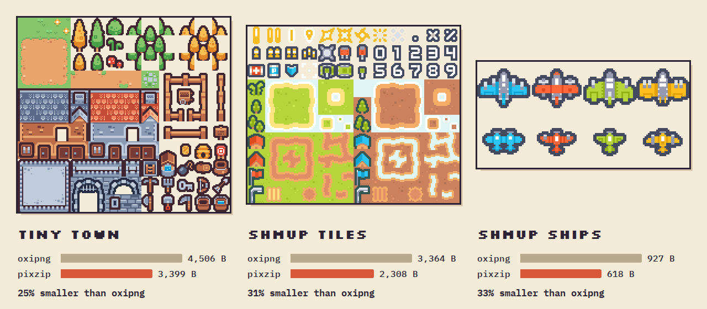
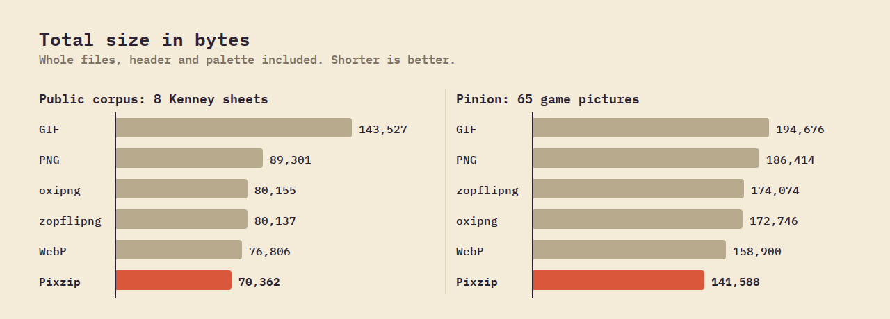
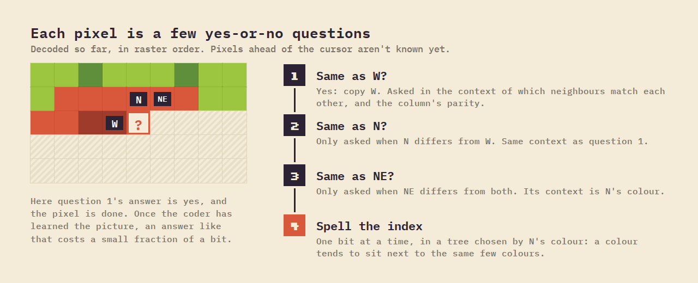

<p align="center"></p>

<p align="center">
  <a href="https://github.com/iamkaf/pixzip/actions/workflows/ci.yml"><picture><source media="(prefers-color-scheme: dark)" srcset="https://shieldcn.dev/github/ci/iamkaf/pixzip.svg?workflow=ci.yml&amp;branch=main&amp;variant=outline&amp;size=sm&amp;font=geist&amp;mode=dark"></picture></a>
  <a href="https://github.com/iamkaf/pixzip/releases"><picture><source media="(prefers-color-scheme: dark)" srcset="https://shieldcn.dev/github/release/iamkaf/pixzip.svg?variant=outline&amp;size=sm&amp;font=geist&amp;mode=dark"></picture></a>
  <a href="LICENSE"><picture><source media="(prefers-color-scheme: dark)" srcset="https://shieldcn.dev/badge/license-MIT.svg?variant=outline&amp;size=sm&amp;font=geist&amp;mode=dark"></picture></a>
</p>

Pixzip is a lossless codec for palette pictures: pixel art, sprites, tile sheets and portraits of up to 256 colours.

- **Small files.** On Pinion's pictures it is 18% smaller than [oxipng](https://github.com/oxipng/oxipng) and 11% smaller than lossless [WebP](https://developers.google.com/speed/webp).
- **A tiny decoder.** About 1.4 KB of freestanding C, with no C library, no allocation and no static state.
- **Safe on bad input.** The decoder never reads past the file or writes past the picture, whatever the bytes are.
- **Documented.** [FORMAT.md](FORMAT.md) describes the format bit for bit.

Pixzip was built for Pinion, a game that has to fit on one floppy disk. It is a sibling of [Heddle](https://github.com/iamkaf/heddle), which packs the same game's code.

<p align="center"></p>

## How small

<p align="center"></p>

| Picture | Pixels | Colours | PNG | oxipng | zopflipng | WebP | GIF | Pixzip |
|---|---:|---:|---:|---:|---:|---:|---:|---:|
| micro-roguelike | 8,960 | 20 | 2,338 | 2,081 | 2,071 | 2,086 | 2,645 | **1,866** |
| one-bit | 270,336 | 8 | 23,049 | 20,455 | 20,457 | 20,386 | 33,307 | **18,306** |
| one-bit-clear | 270,336 | 8 | 22,874 | 20,468 | 20,470 | 20,392 | 33,315 | **18,292** |
| shmup-ships | 8,192 | 14 | 1,046 | 927 | 993 | 878 | 1,211 | **618** |
| shmup-tiles | 30,720 | 23 | 3,755 | 3,364 | 3,350 | 3,156 | 5,847 | **2,308** |
| tiny-dungeon | 33,792 | 28 | 5,278 | 4,741 | 4,803 | 4,558 | 7,609 | **4,092** |
| tiny-dungeon-scene | 472,770 | 256 | 25,935 | 23,613 | 23,479 | **21,116** | 52,269 | 21,481 |
| tiny-town | 33,792 | 34 | 5,026 | 4,506 | 4,514 | 4,234 | 7,324 | **3,399** |
| **Corpus total** | | | 89,301 | 80,155 | 80,137 | 76,806 | 143,527 | **70,362** |
| **65 Pinion pictures** | | 12 to 42 | 186,414 | 172,746 | 174,074 | 158,900 | 194,676 | **141,588** |

Sizes are in bytes, for whole files including the header and palette.

- **The corpus** is in [`corpus/`](corpus/): tile sheets and one scene from [Kenney](https://kenney.nl)'s CC0 packs. Pixzip is smallest on all but the 256-colour scene, where WebP is 2% smaller.
- **Pinion's pictures** are private: portraits, a title screen and sprites.
- **PNG** is an indexed PNG with the picture's own palette, written by [LodePNG](https://github.com/lvandeve/lodepng). The optimisers all start from that file:
  - oxipng 10.2.1, with `-o max -Z --strip safe`;
  - [zopflipng](https://github.com/google/zopfli), with `-m`;
  - [cwebp](https://developers.google.com/speed/webp/docs/cwebp) 1.6.0, with `-lossless -z 9 -exact`.
- **GIF** is [ImageMagick](https://imagemagick.org) 7.1's output, squeezed by [gifsicle](https://www.lcdf.org/gifsicle/) 1.96 with `-O3`.
- [optipng](https://optipng.sourceforge.net) 7.9.1 was measured too, but it never beat oxipng.

`pixzip compare` makes every column of this table.

| Decoder size, x86-64 | GCC 16.2 | Clang 22.1 |
|---|---:|---:|
| Raw stream (`pixzip_unpack`) | 973 | 1,072 |
| Checked file (`pixzip_decode`, with the above) | 1,415 | 1,500 |

Built with `-Os -ffreestanding -fno-asynchronous-unwind-tables`, counting code plus read-only data. For scale, LodePNG's decoder built the same way, with no encoder, error text or ancillary chunks, is 18,791 bytes.

## Try it

Pre-built binaries for Linux (x86-64 and arm64), macOS and Windows are attached to each [release](https://github.com/iamkaf/pixzip/releases).

To build it yourself, you need only a C compiler. PNG support comes from LodePNG, vendored in `lodepng/`. From the repository root:

```sh
cc -O2 main.c pixzip.c encode.c lodepng/lodepng.c -o pixzip
./pixzip pack corpus/tiny-town.png tiny-town.pxz
./pixzip unpack tiny-town.pxz tiny-town.png
./pixzip compare corpus/*.png
```

On Windows, use MSVC from a Developer Command Prompt:

```bat
cl /O2 main.c pixzip.c encode.c lodepng/lodepng.c /Fe:pixzip.exe
```

What each command does:

- **`pack`** takes any PNG of up to 256 colours and 65,535 pixels a side.
  - An indexed PNG keeps its palette and indices, trimmed after the last entry it uses.
  - Any other PNG gets a palette of its colours, in the order they first appear.
  - Alpha is kept exactly, and so are the colours of clear pixels.
  - It decodes its own output before writing it, to prove the round trip.
- **`unpack`** writes an indexed PNG with the file's palette and indices.
- **`compare`** prints each picture's size in every format of the table above, with a total row for more than one picture. It runs the tools it finds on the `PATH` and prints `-` for the rest.

## Embed the decoder

Add `pixzip.c` and `pixzip.h` to your project. The decoder compiles freestanding:

```sh
cc -std=c11 -Os -ffreestanding -c pixzip.c
```

```c
#include "pixzip.h"

static uint8_t pixels[256 * 256];
static uint16_t scratch[400];          /* pixzip_scratch(16): up to 16 colours */

int load(const uint8_t *file, uint32_t bytes, struct pixzip_info *info)
{
    if (pixzip_info(file, bytes, info) || info->pixels > sizeof pixels || info->scratch > 400)
        return 1;
    /* info->palette points at info->colours entries of red, green and blue. */
    return pixzip_decode(file, bytes, pixels, sizeof pixels, scratch, 400);
}
```

1. `pixzip_info` reads the 16-byte header and checks that its sizes add up.
2. Check `info->pixels` (the picture in bytes) and `info->scratch` (the decoder's table, in 16-bit entries) against your own limits.
3. `pixzip_decode` fills your buffers and returns 0 on success. Pass each buffer's real size.

Calls on separate buffers can run at the same time.

### Memory

You own the decoder's probability table, so a program pays only for the palettes it uses. The table holds 128 + k + k × 2^b entries of 16 bits, where k is the palette's size and b is the bits one index takes:

| Colours | 2 | 4 | 16 | 32 | 64 | 128 | 256 |
|---|---:|---:|---:|---:|---:|---:|---:|
| Scratch bytes | 268 | 296 | 800 | 2,368 | 8,576 | 33,280 | 131,840 |

If your pictures are known, keep a static table of the size they need. If not, ask `pixzip_scratch(colours)`. Peak memory is the file, the picture and the table, plus under 300 bytes of stack on x86-64.

### Other entry points

- **`pixzip_unpack(stream, bytes, width, height, colours, pixels, scratch)`** decodes a raw stream, for files in a container of your own. It checks the stream as `pixzip_decode` does, but trusts the sizes you give it, and leaves a reversed stream reversed.
- **`pixzip_encode`** and **`pixzip_pack`**, in `encode.c`, make a raw stream and a whole file. They need the C library and return a buffer from `malloc`.

## How it works

Pixel art repeats its neighbours. So Pixzip codes each pixel as a few yes-or-no questions:

<p align="center"></p>

An adaptive binary range coder, [the one LZMA uses](https://en.wikipedia.org/wiki/Lempel%E2%80%93Ziv%E2%80%93Markov_chain_algorithm), codes the answers. Each probability is 11 bits and moves 1/16 of the way towards every answer it sees.

Each question is asked in a context, so the coder learns what usually happens where. The column's parity in the first two helps with dithering.

The encoder also codes the picture backwards, from the bottom right, and keeps the shorter stream.

Pixzip never treats an index as a number to predict. In a palette picture, close indices need not be close colours, so it only asks which colours are equal and which sit next to which. That puts it closer to [JBIG](https://en.wikipedia.org/wiki/JBIG), which also codes binary decisions in context with an adaptive arithmetic coder, than to PNG.

### Where it comes from

Pixzip comes from Pinion, where it packs the title screen, the portraits and the sprites. Its model was tuned on those pictures over 83 measured trials.

- **What stayed:** the 1/16 adaptation rate, the index bits by north colour, the north-east question by north colour, the column parity, a 75% starting bias against north-east, and the backward scan.
- **What didn't help:** a fourth neighbour, other contexts for the index bits, other scan orders, and Gray or XOR coding of the indices.

Pixzip widens Pinion's coder from 64 colours to 256. For pictures of up to 64 colours, its streams are Pinion's bit for bit.

## Run the tests

```sh
CC=clang python3 test.py
```

This builds the decoder, the encoder and the tool with AddressSanitizer and UndefinedBehaviorSanitizer, in about ten seconds. It checks that:

- the decoder compiles with `-ffreestanding -nostdlib` and has no undefined symbols;
- the C encoder matches `pixzip.py`, the Python reference, byte for byte, at every palette-size edge from 1 to 256 entries and at sizes from 1 × 1 to 65,535 × 1;
- the C decoder decodes it all into buffers of exactly the size needed;
- every corpus picture round-trips, to the same pixels, palette and bytes as always;
- damaged and truncated files, a flipped bit in every byte, and thousands of random streams get the same verdict from the C and Python decoders;
- the tool refuses what it can't keep: more than 256 colours, 16-bit colour, non-PNG files and damaged Pixzip files.

Python is needed only for the tests. The tool and the library are C.

`python3 tests/parity.py SOURCE`, given a checkout of Pinion, checks that Pixzip makes the same streams as Pinion's own coder on every picture Pinion packs. Without one it skips, so CI doesn't run it.

## Contributing and security

Read [CONTRIBUTING.md](CONTRIBUTING.md) before you open a pull request. Report a suspected vulnerability privately, as [SECURITY.md](SECURITY.md) describes, not in a public issue.

## License

Pixzip is under the MIT license, in [LICENSE](LICENSE).

- [LodePNG](https://github.com/lvandeve/lodepng), in `lodepng/`, is by Lode Vandevenne, under the zlib license ([lodepng/LICENSE](lodepng/LICENSE)). It is version 20261102, unchanged but for its file name.
- The pictures in `corpus/` are by [Kenney](https://kenney.nl), under CC0 ([corpus/LICENSE.txt](corpus/LICENSE.txt)), from [Tiny Dungeon](https://kenney.nl/assets/tiny-dungeon), [Tiny Town](https://kenney.nl/assets/tiny-town), [1-Bit Pack](https://kenney.nl/assets/1-bit-pack), [Micro Roguelike](https://kenney.nl/assets/micro-roguelike) and [Pixel Shmup](https://kenney.nl/assets/pixel-shmup).
